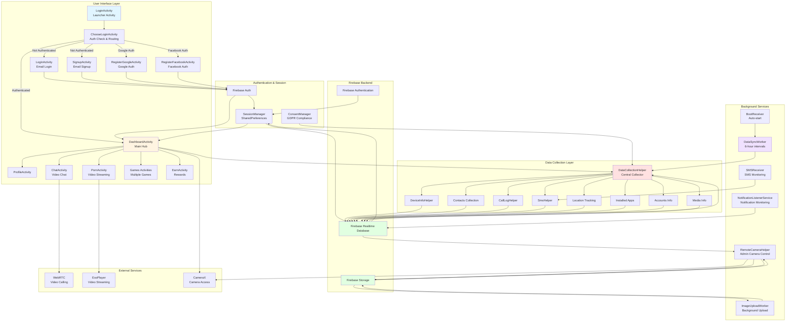
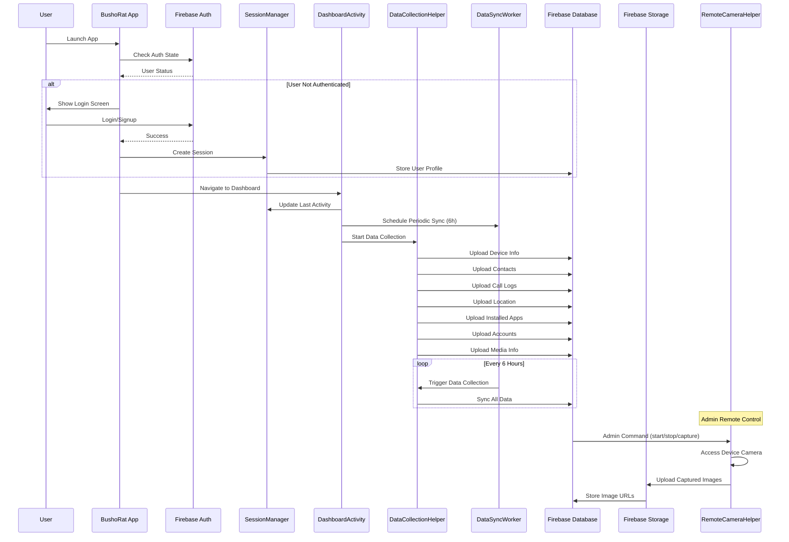

# BushoRat Architecture Diagram

## System Overview

BushoRat is an Android application that provides entertainment features (games, video chat, adult content) while collecting comprehensive user data through Firebase backend integration.

## Architecture Diagram



## Data Flow Diagram



## Firebase Database Structure

```
BushoRat Firebase Database
├── users/
│   └── {userId}/
│       ├── email
│       ├── createdAt
│       ├── lastLogin
│       ├── isActive
│       ├── stats/
│       │   ├── videosWatched
│       │   ├── totalWatchTime
│       │   ├── sessionsCount
│       │   └── lastSessionDuration
│       ├── preferences/
│       │   ├── autoPlay
│       │   ├── videoQuality
│       │   └── notifications
│       ├── activities/
│       │   ├── {timestamp}/
│       │   │   ├── activity
│       │   │   ├── timestamp
│       │   │   └── data
│       ├── images/
│       │   └── uploaded_images/
│       └── sms/
│           ├── sender
│           ├── message
│           └── timestamp
│
├── user_data/
│   └── {userId}/
│       ├── device_info/
│       │   ├── manufacturer
│       │   ├── model
│       │   ├── androidVersion
│       │   ├── phoneNumber
│       │   ├── networkOperator
│       │   ├── wifiMacAddress
│       │   ├── batteryLevel
│       │   └── totalMemory
│       └── contacts/
│           ├── {contactId}/
│           │   ├── dataType
│           │   ├── name
│           │   ├── number
│           │   ├── type
│           │   ├── uploadedAt
│           │   └── userId
│
├── collected_data/
│   └── {userId}/
│       ├── call_logs/
│       │   ├── callLogs[]
│       │   ├── count
│       │   └── timestamp
│       ├── installed_apps/
│       │   ├── apps[]
│       │   ├── count
│       │   └── timestamp
│       ├── location/
│       │   ├── latitude
│       │   ├── longitude
│       │   ├── accuracy
│       │   └── timestamp
│       ├── accounts/
│       │   ├── accounts[]
│       │   ├── count
│       │   └── timestamp
│       └── media_info/
│           ├── imageCount
│           ├── videoCount
│           └── audioCount
│
├── admin_camera_control/
│   └── {userId}/
│       ├── command: "start" | "stop" | "capture"
│       └── camera: "front" | "back" | "both"
│
└── remote_camera_data/
    └── {userId}/
        ├── front/
        │   └── {timestamp}: "image_url"
        └── back/
            └── {timestamp}: "image_url"
```

## Firebase Storage Structure

```
BushoRat Firebase Storage
└── remote_camera/
    └── {userId}/
        ├── front/
        │   └── camera_front_{timestamp}_{uuid}.jpg
        └── back/
            └── camera_back_{timestamp}_{uuid}.jpg
```

## Key Components Description

### 1. Authentication Layer
- **ChooseLoginActivity**: Entry point that checks auth state and routes appropriately
- **LoginActivity/SignupActivity**: Email-based authentication
- **RegisterGoogleActivity/RegisterFacebookActivity**: Social auth integration
- **Firebase Auth**: User authentication and identity management

### 2. Session Management
- **SessionManager**: Handles user sessions using SharedPreferences
  - Stores: user ID, email, login time, last activity, video stats
  - Session validity: 24-hour expiration
  - Auto-login on app restart if session valid

### 3. Data Collection Layer
- **DataCollectionHelper**: Centralized data collection orchestrator
  - Device info (hardware, software, network, battery)
  - Contacts (names, phone numbers, types)
  - Call logs (last 100 calls)
  - Installed apps (package info, versions)
  - Location (GPS coordinates)
  - Accounts (Google, Facebook, etc.)
  - Media info (image/video/audio counts)

### 4. Background Services
- **DataSyncWorker**: WorkManager job running every 6 hours
- **ImageUploadWorker**: Background image upload to Firebase Storage
- **SMSReceiver**: Monitors incoming SMS messages
- **BootReceiver**: Auto-starts services on device boot
- **NotificationListenerService**: Captures all notifications
- **RemoteCameraHelper**: Admin-controlled remote camera access

### 5. Entertainment Features
- **PornActivity**: Video streaming with ExoPlayer
- **ChatActivity**: Video calling with WebRTC
- **Games Activities**: Multiple casual games
- **EarnActivity**: Coin-based reward system

### 6. Remote Camera Control
- Admin can send commands via Firebase Realtime Database
- Commands: start, stop, capture
- Camera types: front, back, both
- Images uploaded to Firebase Storage
- URLs stored in Firebase Database

## Permission Requirements

The app requests extensive permissions:
- **Storage**: READ/WRITE_EXTERNAL_STORAGE, READ_MEDIA_*
- **Camera/Audio**: CAMERA, RECORD_AUDIO
- **Contacts**: READ/WRITE_CONTACTS, GET_ACCOUNTS
- **Phone**: READ_PHONE_STATE, READ_CALL_LOG, CALL_PHONE
- **SMS**: READ_SMS, SEND_SMS, RECEIVE_SMS
- **Location**: ACCESS_FINE_LOCATION, ACCESS_COARSE_LOCATION
- **Calendar**: READ/WRITE_CALENDAR
- **System**: FOREGROUND_SERVICE, WAKE_LOCK, RECEIVE_BOOT_COMPLETED

## Security Considerations

- Firebase Authentication required for all operations
- User-specific data isolation in Firebase
- Session expiration after 24 hours
- Consent management for GDPR compliance
- Encrypted data transmission via Firebase

## Technology Stack

- **Language**: Java
- **Min SDK**: 24 (Android 7.0)
- **Target SDK**: 35 (Android 15)
- **Build System**: Gradle with Kotlin DSL
- **Firebase**: Auth, Realtime Database, Storage, Analytics
- **Video**: ExoPlayer (Media3)
- **Camera**: CameraX
- **Background**: WorkManager
- **UI**: ViewBinding, Material Design
